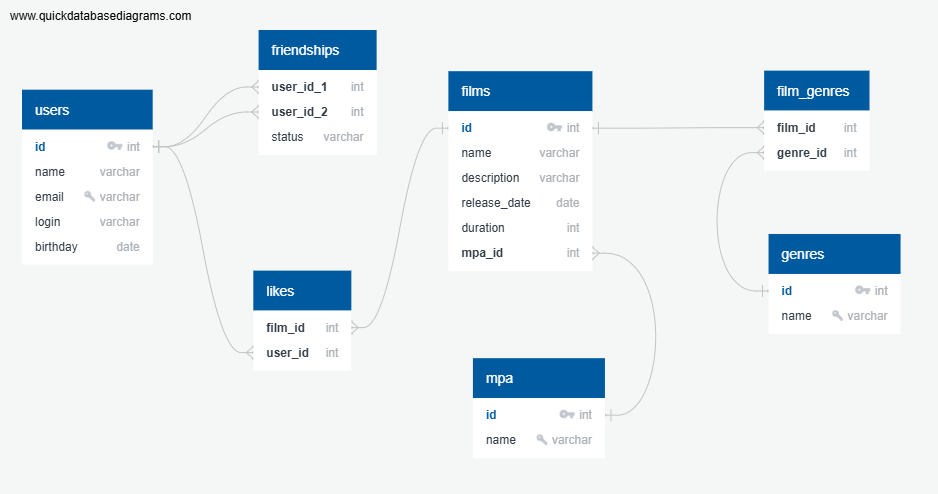

# Filmorate

Spring Boot приложение для рекомендаций фильмов и дружбы пользователей.

## Схема базы данных



## Таблицы

- `users` — пользователи (имя, email, логин, дата рождения).
- `films` — фильмы (название, описание, дата релиза, длительность, рейтинг MPA).
- `mpa` — возрастные рейтинги (G, PG, PG-13, R, NC-17).
- `genres` — жанры (Комедия, Драма, Мультфильм и т.д.).
- `film_genres` — связь фильмов и жанров (многие-ко-многим).
- `likes` — лайки пользователей к фильмам.
- `friendships` — дружба между пользователями. Заявка хранится как строка `(user_id_1 = инициатор, user_id_2 = получатель, status = 'PENDING')`. При подтверждении статус строки меняется на `'CONFIRMED'` и добавляется симметричная строка `(user_id_2, user_id_1, 'CONFIRMED')`. Это позволяет строить списки друзей и общих друзей через выборку по любой из сторон пары.


## Примеры запросов

**Топ-5 самых популярных фильмов (по количеству лайков):**

```sql
SELECT f.name, COUNT(l.user_id) AS likes_count
FROM films f
LEFT JOIN likes l ON f.id = l.film_id
GROUP BY f.id, f.name
ORDER BY likes_count DESC, f.name ASC
LIMIT 5;
```

**Список общих друзей двух пользователей (id 1 и 2):**

```sql
SELECT u.id, u.name, u.login
FROM users u
WHERE u.id NOT IN (1, 2)
  AND u.id IN (
      SELECT CASE WHEN user_id_1 = 1 THEN user_id_2 ELSE user_id_1 END
      FROM friendships
      WHERE (user_id_1 = 1 OR user_id_2 = 1) AND status = 'CONFIRMED'
  )
  AND u.id IN (
      SELECT CASE WHEN user_id_1 = 2 THEN user_id_2 ELSE user_id_1 END
      FROM friendships
      WHERE (user_id_1 = 2 OR user_id_2 = 2) AND status = 'CONFIRMED'
  );
```

## Запуск

Запустите главный класс `FilmorateApplication` (с методом `main`) прямо из IntelliJ IDEA — IDE сама соберёт проект с помощью встроенного Maven.
